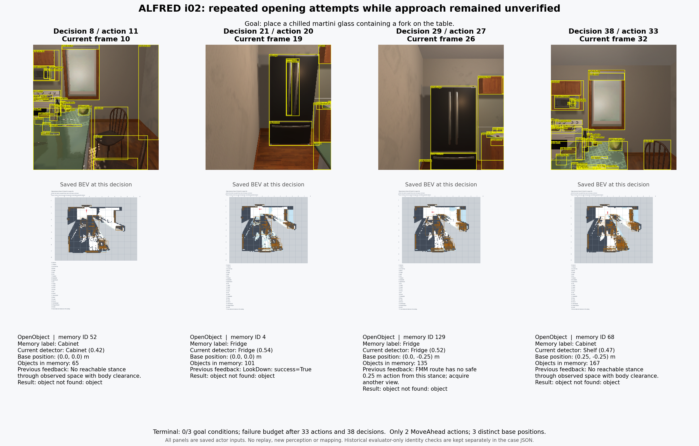
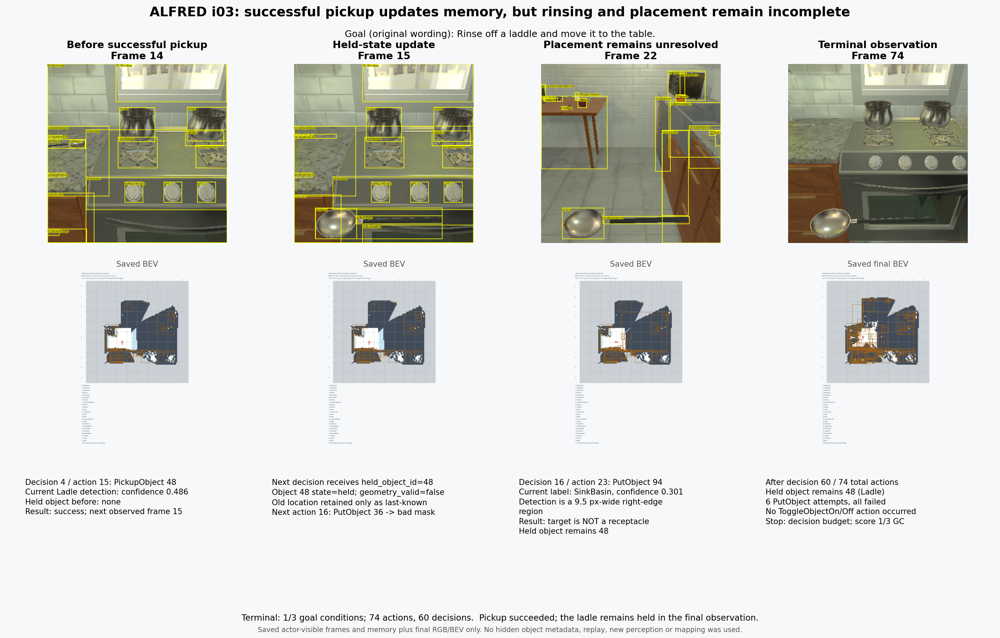

# v10: online mapping prefix5 results and two episode replays

Date: 2026-11-05. **All five requested tasks reached official terminal scoring:
SR 0/5, GC 1/12 = 8.33%, PLW-SR 0%, PLW-GC 3.78%.** All five independently
recomputed official goal scores agree. This establishes end-to-end execution;
it does not establish successful task performance.

The user reduced the planned pilot15 to five tasks while execution was underway.
The scored cohort is exactly original frozen indices **0–4**, with no replacement,
resampling or scored retries. All five are `valid_seen`; this is a diagnostic
prefix, not a completed balanced pilot15 or an unseen-validation result.
The original [pilot15](folds/pilot15.json) remains unchanged.
[Exact selection and complete attempt ledger](assets/v10_prefix5_20261105/pilot5_selection_20261105_v2.json).

## Frozen implementation and input

- Branch `feat/alfred-benchmark`, all five actual run HEADs
  `62e9f18a6654bbedb1558b3ae2a08cc7f2207a6f`.
- Executed-source SHA-256:
  `547bf610324ba30dcdc76e4e4cfe9ccf8d01d593df8f84c4f0dddaaf3d0107aa`;
  clean source at launch, no actor-code/config changes during the scored cohort.
- Parent fold SHA-256:
  `2fa0520b130ec9748762b31b7dc1c3aeeb072edbb5bb7e9393ea4c406da1f34a`.
- H instructions; fixed 114-category GroundingDINO/SAM1/OpenCLIP perception,
  DA3Metric-Large depth, action odometry and yaw/pitch proprioception.
  Our OpenEQA mapping method is extended with stable IDs, current evidence,
  separate occupancy/coverage, real FMM and frontier exploration.
- Native Responses `gpt-5.4-2026-03-05`, medium. Per-task ceilings:
  1,000 attempted actions, 10 failed simulator actions, 60 decisions;
  navigation chunk 12 and at most three retrieved historical images.
- Inference physical GPU 4, resolved to its UUID; renderer on existing GPU 6.
  Physical GPU 1 was not used by this work. The first five were launched
  concurrently, with the first task starting before the other four.
- Exact model/checkpoint/source hashes, train-only depth comparison and all setup
  failures are in [v9](v9_online_mapping_20261105.md). DA3 won the frozen 60-frame
  train AbsRel comparison (0.19530 versus 0.41473), with no GT scale fitting.

Exact command vectors and per-run configuration/receipts are archived under
`assets/v10_prefix5_20261105/runs/ALFRED_V9_20261105_pilot15_i00` through `i04`.
The [common argument vector](assets/v10_prefix5_20261105/pilot_common_command.json)
uses `--num-shards 15`; each run adds its original `--shard-index 0..4`, unique
run ID and output directory. Raw observations, detections, depth, features,
interaction masks, decisions, memory and official snapshots remain under
`outputs/alfred/ALFRED_V9_20261105_pilot15_iXX/`.

## Official results and matched reference

| Run | Task | Completed / total goals | Actions / failed | Decisions | Termination |
|---|---|---:|---:|---:|---|
| i00 | Examine pillow under lamp | 0/2 | 62 / 2 | 60 | decision_budget |
| i01 | Place spray bottle in toilet | 0/1 | 91 / 10 | 45 | failure_budget |
| i02 | Place fork in glass on table | 0/3 | 33 / 10 | 38 | failure_budget |
| i03 | Clean ladle and place on table | 1/3 | 74 / 7 | 60 | decision_budget |
| i04 | Cool plate and place on counter | 0/3 | 57 / 3 | 60 | decision_budget |

| Configuration | Same five identities | SR | GC | PLW-SR | PLW-GC | Actions |
|---|---:|---:|---:|---:|---:|---:|
| Historical v8 | 5 saved scores | 20.00% | 25.00% | 15.71% | 31.44% | 164 |
| Online OpenEQA mapping | 5 new scores | 0.00% | 8.33% | 0.00% | 3.78% | 317 |

The reference was obtained by exact episode/trajectory matching against existing
v8 results, without rerunning them. Both cohorts use the same registered model
and medium effort. Perception, memory and navigation change together, so this
is a bundled-system comparison on a small seen prefix, not an isolated estimate
of the value of incremental memory. The new results are worse on this prefix.
[Complete metrics, per-task provenance and corrected comparison](assets/v10_prefix5_20261105/pilot5_final_audit_02.json).
The original final audit is preserved; the second file corrects an earlier
explanatory claim about effort, without changing any score or token count.

## Calls, images, runtime and validation

The five scored tasks generated 317 actions, 32 failed actions, 322 observations
and 36 masked interactions. There were 263 saved decision requests/responses and
264 observed SDK attempts. Decision attachments total 540 images, including 14
historical images. Response-reported usage is **11,048,397 input tokens and
361,208 output tokens**; image counts do not expand every wire retransmission.

The observed launch-to-last-completion span was **3,241.68 seconds (54.03 minutes)**,
including startup gaps, parallel overlap and overlap with later-cancelled tasks.
Summed policy time is 10,255.02 seconds and summed perception-RPC time is 1,507.77
seconds; neither sum is elapsed wall time. The RPC number includes GPU-lock waiting
and artifact handling, not just neural kernels. In completed i02, policy time was
1,526.57 of 1,947.11 elapsed seconds. Remaining time cannot be labelled pure mapping.

Verification includes 5/5 independent, hash-pinned official-goal AST checks on
saved terminal states; 5/5 SQLite/provenance matches; all 36 executed masks matched
saved current mapping masks; and 263 SDK catalogs/traces showed no host-tool
execution or detected forbidden evaluator fields. These checks do not prove
mask-to-real-object semantic correctness, nor replace a full wire capture for
every call. [Audit boundaries and limitations](assets/v10_prefix5_20261105/pilot5_final_audit_02.json).

Before evaluation, Ruff, Black, mypy, 1,432 source tests and 440 adapter tests
passed; adapter total coverage with branch measurement was 91.34%. Source gates
were repeated after the signed-pitch capture/consumer fix. No NR3D, OpenEQA or
SceneFunc3D preprocessing/evaluation source was modified. See the exact
[v9 validation records](v9_assets/quality_gates_frame_id_fix.json).

## Two visualized episodes

The figures and videos use saved actor evidence; no model inference, simulator
replay or mapping recomputation was performed for visualization. Each video has
one second per decision and a terminal frame, explicitly **not real time**.
An upcoming decision is labelled separately from the previous action feedback.
The BEV catalog is cropped by the frozen renderer layout while retaining the map.
[Video/frame/source manifest](assets/v10_prefix5_20261105/replay_manifest.json).

**i02: container search and failed opening.** [Full 39-second video](assets/v10_prefix5_20261105/i02_decision_replay.mp4). All ten OpenObject
actions failed. One current mask was verified fresh but the remembered Cabinet
label corresponded to a current Shelf detection and simulator dispatch to a
Microwave. Only the final-step terminal snapshot supports its final visibility
and distance; that truth is not applied to earlier steps. Another case shows
contained-mask subtraction removing regions labelled Footstool/Curtains from a
Fridge mask. These observations identify target/region/readiness inconsistencies;
they do not establish that one component alone caused the failure.
[Case evidence and inference limits](assets/v10_prefix5_20261105/i02_terminal_failure_cases.md).

**i03: successful pickup and subsequent placement failures.** [Full 61-second video](assets/v10_prefix5_20261105/i03_decision_replay.mp4).
The runtime records successful PickupObject of memory ID 48, then held ID changes
from none to 48 and that object's world geometry becomes invalid. Six PutObject
actions fail, no Toggle action is recorded, and the terminal score is 1/3. This
shows an actual incremental state update while the complete task still fails.

Videos, full-resolution figures and the interactive replay data are retained in
`outputs/alfred/visualizations_prefix5_20261105/`:
`i02_decision_replay.mp4` and `i03_decision_replay.mp4`. The interactive view uses
14 saved snapshots plus the recorded odometry trajectory. Its selection, slider,
finite playback and state logic passed Node/DOM checks; no browser layout test
is claimed. [Artifact paths and hashes](assets/v10_prefix5_20261105/archive_manifest.json).

## Scope reduction, cancelled work and archive

The first attempt to stop future queues suspended supervisors but did not
permanently prevent continuation. Besides already-started i06, i05/i07/i08 also
started; all four were cancelled and none contributed a score. This was an
orchestration mistake, not an infrastructure failure of the five scored tasks.
The supervisors were permanently terminated, and a process audit confirmed no
project ALFRED runner/perception/simulator worker remained.

The four excluded attempts consumed 77 actions, 51 requests/49 responses and
105 decision image attachments. Reported usage is at least 966,591 input and
55,182 output tokens; two unanswered requests have unknown usage. These costs
are separate from the scored-cohort totals.
[Full excluded-work accounting](assets/v10_prefix5_20261105/pilot5_excluded_user_cancellations_v2.json).

The native i06 receipt is interrupted with no score. i05/i07/i08 were terminated
before native final receipts were written, so their raw files honestly retain
running/pending state. Their SQLite records explicitly identify **derived external
user cancellation**, retain raw hashes and exit/cleanup evidence, and use null
for unknown times and scores; raw files and the five scored rows were not altered.
All nine started task runs are now archived: five completed and four interrupted.
[External cancellation verification](assets/v10_prefix5_20261105/external_cancellation_sqlite_01.json).
Five setup/calibration/transport diagnostics are additionally stored in a separate
`diagnostic_runs` table, never as scored episodes.

## Findings to discuss next

The current evidence points to detection/instance/interaction-region consistency,
interaction readiness after navigation, and repeated unsuccessful decisions as
immediate reliability questions. These were observed and recorded, not tuned away
on the five validation tasks. Generated local policy programs remain future work.

A separate read-only performance review found repeated oriented-box/convex-hull
fitting in association and periodic merge loops. Phase-local caching and an
AABB-distance rejection before expensive overlap work are candidates for a future
semantics-preserving optimization. Static operation-count reductions are not
measured end-to-end speedups; no such optimization was inserted into this frozen
cohort. [Evidence and precise limits](assets/v10_prefix5_20261105/mapping_performance_review.md).
