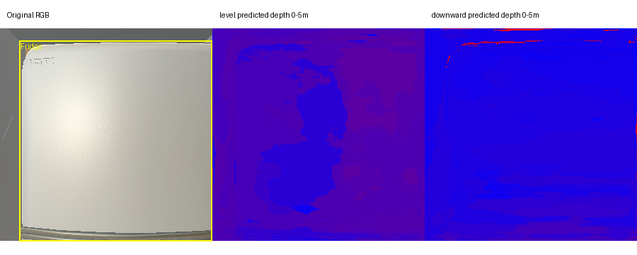
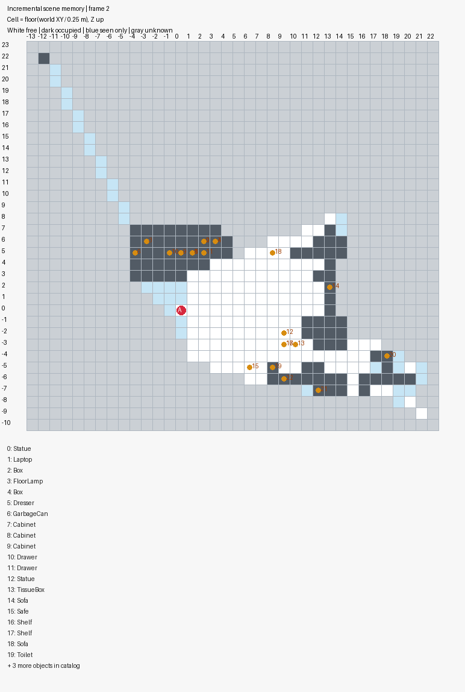

# ALFRED v1 setup — 2026-11-05

The simulator subprocess and predicted perception backend passed infrastructure
smoke checks. **No LLM-controlled episode was scored, and pilot50 has not run.**
These checks establish dependency/API readiness only. They do not establish
navigation quality, reliable instance association or task success.

## Provenance and intended evaluation

| Item | Value |
|---|---|
| Working branch | `feat/alfred-benchmark` |
| Base HEAD | `debd961b7d6d848518d415635afd55b85dc1f41b` |
| Setup source state | New, uncommitted implementation; per-file executed-code hash was not captured for these infrastructure checks |
| Official ALFRED checkout | `/home/ysh/Datasets/FILM/alfred`, `f91f4c0c96c7a29f33d0557f86b0a21035379b3b` |
| Local FILM checkout | `/home/ysh/codebase/FILM`, `63abf9599bbcfae0b2ab91695da86fcca751f044` |
| FILM upstream reference | `e879a2c1289a8847076a8068e81fcbf3eb994265` |
| HLSM research checkout | `9e3096536c09e1fff2b90e7202419f7fcfda2cd1` |
| LLM-Planner project-page checkout | `dki-lab/LLM-Planner`, `81438d8f27777a010cde3e828572f08b5721eafb`; this is the project webpage, not the implementation |
| Simulator | AI2-THOR 2.1.0, Linux build 201909061227 |
| Main / legacy Python | `agentic3d` / `/home/ysh/codebase/FILM/.venv/bin/python` (3.8.20) |
| Perception torch | 1.13.1+cu117, published FILM checkpoints, TF32 disabled |
| Intended fold | Frozen `folds/pilot50.json`, seed 0, 25 seen + 25 unseen, seven task types |
| Agent model / judge | `gpt-5.4`, low effort, exercised only on a synthetic Stop protocol probe; official ALFRED terminal scorer, no LLM judge |
| Scored metrics / DB ingestion | None; no scored evaluation invocation to ingest |

The next evaluation must record its own committed HEAD, executed-code hash,
source/checkpoint/fold hashes, exact command and model identity. This setup
record must not be relabeled as a scored run. `AGENTS.md` requires a clean
tracked tree before evaluation and user authorization before committing; the
source gate also rejects untracked executable files.

## Actual infrastructure checks

The simulator check restored one validation scene, collected the initial RGB,
then executed a right turn and a downward look. All three observations had
successful action feedback. Closing the worker removed its owned Unity process
group. No terminal score was requested. Retained evidence:
[simulator lifecycle report](assets/v1_simulator_smoke_20261105.json).

An isolated calibration measured vertical FOV **60°**, standing camera height
**1.57605648 m**, and camera offset above the simulator's agent origin
**0.67500008 m**. The implementation uses height 1.576 m with a floor-relative
world frame, not 0.675 m as the total camera height. Calibration metadata stays
outside actor observations. [Calibration report](assets/v1_camera_calibration_20261105.json).

The perception check used one previously saved RGB frame from FILM and evaluated
both 0°/45° model-routing paths. The same image was intentionally supplied to
both routes; this is **not** a depth-calibration test. A single persistent worker
loaded four released checkpoints, produced finite 300×300 metric depth, and
detected a refrigerator with confidence 0.99937.

This first perception smoke used the subsequently corrected RGB depth input.
Its artifacts are retained as historical infrastructure evidence, not validation
of final depth quality. The detector's RGB channel order was already correct.

| Measured quantity | Result |
|---|---:|
| Model initialization | 8.56 s |
| Two predictions combined | 2.74 s |
| Total wall time | 11.37 s |
| Worker peak allocated CUDA memory | 856,294,400 bytes (~817 MiB) |

Physical GPU 0 was shared with an existing workload (about 10 GB already used,
100% utilization at launch). No unrelated process was stopped. These timings
are observational, not a throughput benchmark. Reports and image were copied
into this archive:
[prediction/timing JSON](assets/v1_perception_smoke_20261105.json),
[visual preview](assets/v1_perception_preview_20261105.png).

A separate synthetic SDK probe returned the explicitly requested structured
Stop decision using `gpt-5.4` with low effort: **4.786 s**, **6,441 input tokens**,
**92 output tokens**. It verifies schema delivery and actor tool isolation; it
does not demonstrate autonomous planning or scene interaction. The
[distilled report](assets/v1_policy_probe_20261105.json) retains no SDK session
identifiers or private runtime directory metadata.



Actual setup commands, each launched inside its own tmux session:

```bash
bash tmp/alfred_setup/run_simulator_smoke.sh
bash tmp/alfred_setup/run_camera_calibration.sh
bash tmp/alfred_setup/run_perception_smoke.sh
```

The perception launcher activates `agentic3d`, then executes
`python tmp/alfred_setup/perception_smoke.py`. That script calls `FilmPerception`
with the paths in the [setup guide](../../codex_agent/alfred.md), device `cuda:0`,
default thresholds 0.5, and input
`/home/ysh/codebase/FILM/reproduction/smoke/simulator_rgb.png`. It requests
`frame_id=level,horizon_degrees=0` and `frame_id=downward,horizon_degrees=45`.
Model files under the configured weights root are:

```text
maskrcnn_alfworld/objects_lr5e-3_005.pth
maskrcnn_alfworld/receps_lr5e-3_003.pth
depth_models/valts0/model-102500-best_silog_17.00430
depth_models/valts/model-2000-best_silog_10.13741
```

Original local logs are `tmp/alfred_setup/simulator_smoke.log`,
`camera_calibration.log`, `perception_smoke.log`, and
`perception_smoke/worker.stderr.log`. A preliminary perception launcher exited
before inference because conda activation was run with shell `nounset`; moving
`set -u` after activation fixed that launcher. No model or benchmark result was
produced by the failed launcher.

## Verification and remaining limits

The follow-up three-frame integration exposed and fixed two errors before any
task evaluation: the depth checkpoint requires BGR input, and new observed-floor
evidence must clear old perceptual occupancy. Collision evidence now has a
separate lifetime. Reusing the same corrected predicted observations, the memory
retains 3 frames and 23 predicted instances, with 139 free and 87 occupied cells.
These counts describe artifacts, not detection accuracy. Source observations
were the reset/right-turn/downward-look images above; no task goal or score was
used. [Integration report](assets/v1_incremental_memory_20261105.json).



A follow-up [actor tool audit](assets/v1_actor_tool_audit_20261105.json) exercised
the final isolation configuration. A transparent local relay forwarded the
native Responses bytes unchanged and recorded only model/tool names, with no
credential logging. The actual SDK request contained **zero tools** and kept
the exact `gpt-5.4-2026-03-05` model. The synthetic Stop decision completed in
6.611 s using 2,203 input tokens; this also is not an ALFRED task evaluation.
This check followed fixes for SDK catalog overrides that could re-enable tools
and a removed feature toggle that did not disable `apply_patch`.

Final integration gates passed: `ruff check src/`, `black --check src/`,
`mypy src/` (291 files), `pytest src/ -q` (**1,215 passed**), and the separate
adapter suite (**440 passed**, **91.34% branch-inclusive coverage**, threshold
80%). `mkdocs build` passed with pre-existing archived-link/navigation warnings.
Standalone workers compiled under the existing FILM Python 3.8. Regressions
cover channel order, simulator pitch roundoff, current-frame interaction masks,
occupancy corrections, collision lifetime, tool isolation, official metrics and
partial failure archival. No existing benchmark implementation was changed.

Current limitations include 0.1 m depth bins capped at 4.9 m, nearest-checkpoint
pitch routing, class-limited Mask R-CNN detection, RGB-histogram appearance
association, odometry drift, and observation-based state changes. The baseline
does not yet implement generated local policy programs or the proposed complete
execution-verification research method. Its proprioceptive/action-success
inputs also differ from strict leaderboard RGB-only rules. No comparison with
FILM, HLSM or full-split published scores is justified by these setup checks.
