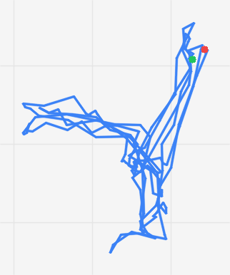
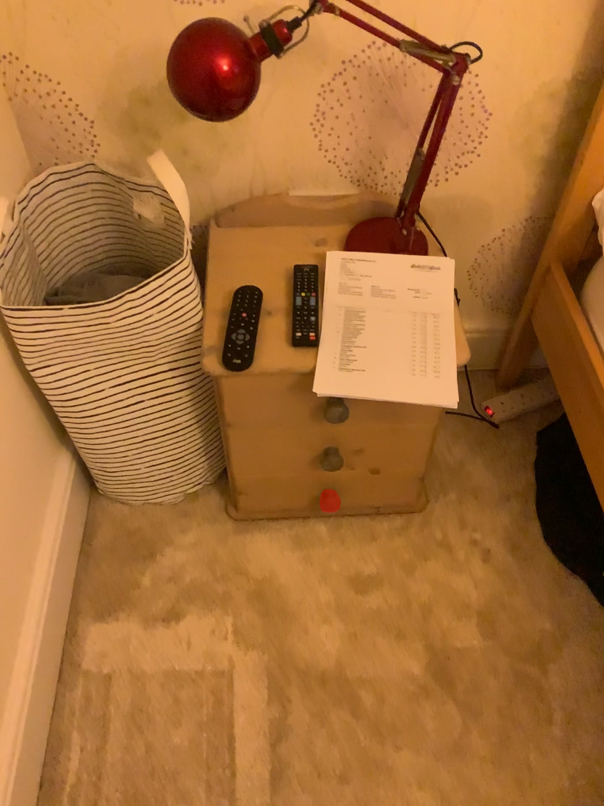
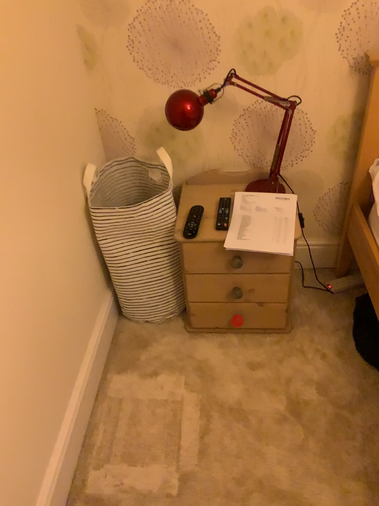
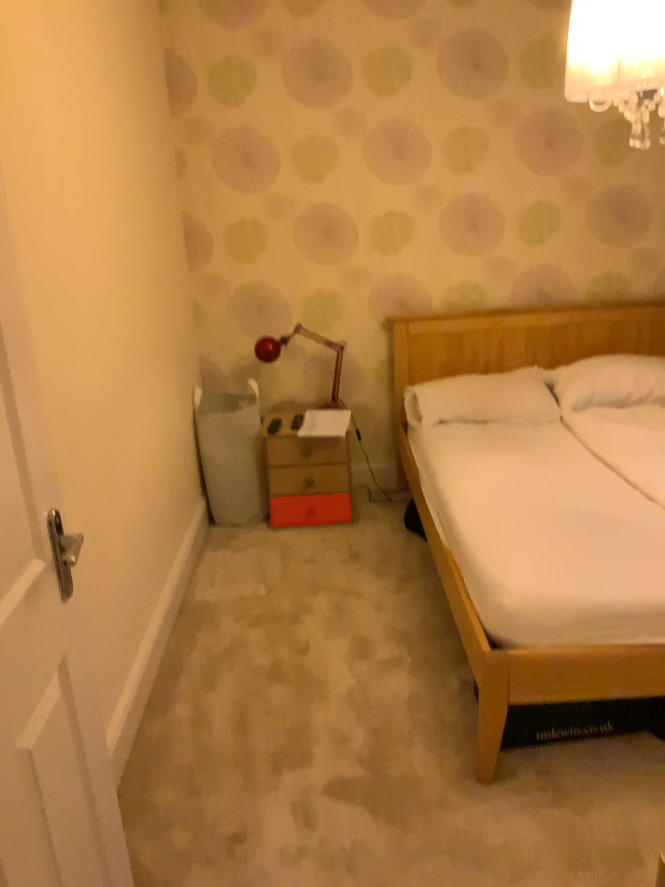
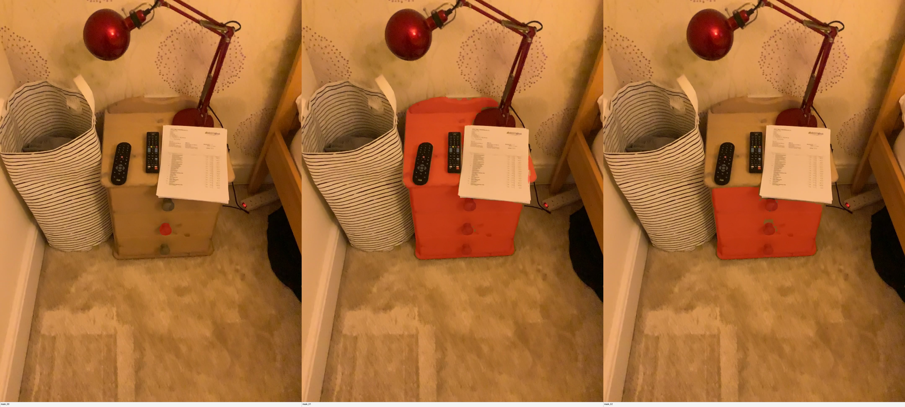
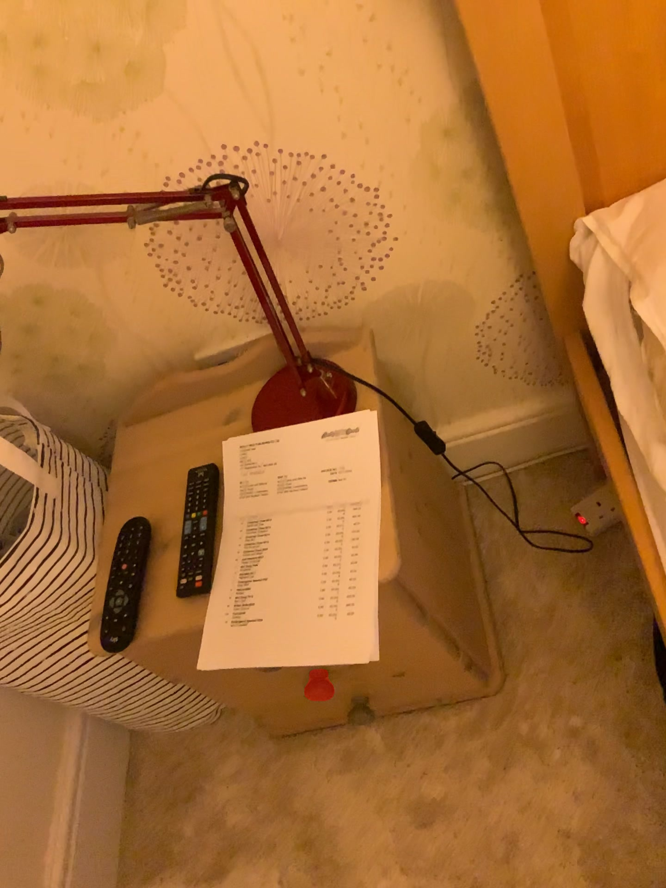

# v8.1 case traces — two successful reasoning paths (2026-07-03)

Detailed end-to-end visualization of the Phase-2c pipeline on **two of the most
successful cases** from the [v8.1 full-20 `421254` run](v8_1_full20_421254_20260703.md).
Both come from SceneFun3D scene `421254`; these are the **original benchmark queries**
each case has to ground (verbatim from `421254_descriptions.json`):

!!! quote "Original SceneFun3D queries — the task each case must ground"

    <p style="font-size: 1.5em; font-weight: 700; line-height: 1.4; margin: 0.4em 0;">Case A · <code>55b56254…</code><br>“Open the <u>bottom</u> drawer of the nightstand with the red table lamp on top”</p>

    <p style="font-size: 1.5em; font-weight: 700; line-height: 1.4; margin: 0.4em 0;">Case B · <code>f35fb167…</code><br>“Open the <u>second</u> drawer of the nightstand with the red table lamp on top”</p>

| Case | Sample (`421254::`) | Original query (SceneFun3D) | Agent-grounded target | IoU | P / R / F1 | pred / GT |
|---|---|---|---|---:|---|---|
| **A** | `55b56254…` | "Open the **bottom** drawer of the nightstand with the red table lamp on top" | bottom drawer knob | **0.545** | 0.79 / 0.64 / 0.71 | 61 / 75 |
| **B** | `f35fb167…` | "Open the **second** drawer of the nightstand with the red table lamp on top" | middle drawer knob | **0.482** | 0.54 / 0.82 / 0.65 | 123 / 80 |

These two are picked deliberately: **same scene, same evidence frame (`000019`),
same base SAM candidate (`mask_00`)** — the only thing the query changes is *which
drawer it names* (**"bottom"** vs **"second"**). Note the agent grounds "second
drawer" as the **middle** knob, so that single affordance decision flows
Molmo → SAM → the frozen 3D anchor → the fused mask into two different 3D targets.
They make the whole "2D-seed → deterministic anchor multi-view pipeline" contract legible.

## Provenance & image notes

- **Run-id dir:** `tmp/scenefunc3d/artifacts/sf3d_phase2c_20cases_20260703_051303/`
  (code commit `d73aa06`, branch `feat/scenefunc3d-agent-tools`). Original queries
  read from `data/SceneFun3D/421254/421254_descriptions.json` (keyed by `desc_id`).
- **Images** are copied **byte-for-byte** (`cp -p`, verified with `cmp`) from that
  run dir into `assets/v8_1_traces/` — **no re-encoding, no
  downscaling**. Frames are full ARKit resolution **1440×1920**; SAM contact sheets
  are **4320×1944** (three candidates side by side). Open an image directly for
  pixel-level detail.
- Per-stage 3D artifacts (lift fragments, fused mask) are **numeric** (`.npz`/`.ply`
  + a `lift_overlay.txt` provenance stub) — SceneFun3D produces no rendered 3D
  overlay, so the 3D stages are shown as point-count tables, not pictures.

## The pipeline in one picture

```
[ agent — ONE LLM turn ]                              [ deterministic runner — no LLM ]
A. seed + verify  ──confirm 2D seed──▶  B. visibility  ──▶  C. per-frame        ──▶  D. layered fusion ──▶ final mask
   scene_summary / keyframe /              project anchor      Molmo+SAM+lift          agreement gate         (+ confidence)
   view_bev / view_frame /                 to every frame,     per selected frame,     + anchor radius gate
   frame_objects → molmo_point             depth-occlusion     anchor-consistency      + connected cluster
   → sam_mask → SeedConfirmation           test, top-N         gate per frame          → keep anchor cluster
```

Stage A is the only place a model reasons; B/C/D are deterministic code. The agent
emits a small `SeedConfirmation` (`seed_frame_id`, `seed_candidate_id`,
`affordance_concept`, `approval_actions`, `uncertainties`) and stops — it does **no
3D work**. The runner lifts that 2D SAM mask to 3D, freezes a `TargetAnchor`
(centroid + motion-capped radius), and runs B/C/D.

---

# Case A — `55b56254…` "Open the bottom drawer of the nightstand with the red table lamp on top"

!!! quote "Original SceneFun3D query · Case A"

    <p style="font-size: 1.6em; font-weight: 700; line-height: 1.4; margin: 0.35em 0;">“Open the bottom drawer of the nightstand with the red table lamp on top”</p>

    Sample `421254::55b56254-acf7-47f9-80f4-368e10816622` · verbatim from `421254_descriptions.json`.

Agent turn: 211.9 s. Confirmed seed **frame `000019`, candidate `mask_00`**,
affordance concept **"the bottom drawer knob of the nightstand with the red table
lamp"**. Final: **IoU 0.545** (61 predicted vs 75 GT points), fusion confidence
**0.947**.

## Stage A.1 — Keyframe finding (agent explores the scene)

The agent's tool sequence (from `events.jsonl`), in order:

```
scene_summary → keyframe_selector → view_bev
→ view_frame ×12 (000106, 000102, 000098, 000094, 000090, 000099, 000097,
                  000019, 000007, 000011, 000015, 000023)
→ frame_objects (000099, 000098)
→ molmo_point → sam_mask → [SeedConfirmation]
```

It first grounds itself with a **top-down schematic BEV** to understand the room
layout, then opens a dozen candidate first-person frames and lists detected objects
in two of them before committing to the nightstand view `000019`.

**Top-down BEV the agent saw (`view_bev`):**



**The evidence frame it settled on (`view_frame 000019`, full 1440×1920):** the
nightstand with the red table lamp; the two drawer knobs are the candidate
affordances.


## Stage A.2 — Molmo point (task-conditioned pointing)

The agent calls `molmo_point` on `000019` with the Fun3DU-style task-conditioned
prompt **"Point to the center of the bottom drawer knob on the nightstand with the
red table lamp on top."** Molmo returns a single point; the runner overlays it on
the frame:

Raw Molmo output: `<points coords="<POINT_1772><POINT_2762>…">center of the bottom
drawer knob on the nightstand with the red table lamp on top.</point>` → pixel
**(785.6, 1193.3)**.


## Stage A.3 — SAM candidates + agent selection

The Molmo point seeds `sam_mask` on `000019`. SAM returns three candidates; the runner
renders a **contact sheet** (4320×1944 — three candidates side by side) for the agent
to verify **on the original image**:


The agent approves **`mask_00`** — the compact mask tightly covering the operable knob
(not the drawer front or the cabinet body):



## Stage A.4 — Seed confirmation (the agent's entire output)

The turn ends by emitting the small `SeedConfirmation`; the agent does **not** lift to
3D or inspect geometry:

```json
{
  "seed_frame_id": "000019",
  "seed_candidate_id": "mask_00",
  "affordance_concept": "the bottom drawer knob of the nightstand with the red table lamp",
  "approval_actions": ["select_evidence", "propose_molmo_point", "approve_molmo_point",
                       "propose_sam_candidates", "approve_sam_candidate"],
  "uncertainties": []
}
```

The runner then deterministically lifts `sam/000019/candidates/mask_00.npz` to the raw
mesh (**2362 points**) using `000019`'s depth + intrinsics + pose, and freezes a
`TargetAnchor` (centroid + `pinch_pull`-capped radius) from those points.
(`fragments/000019_mask_00/lift_overlay.txt`.)

## Stage B — Visibility projection (deterministic)

The anchor is projected into every frame with a depth-occlusion test; the top-scoring
**30 frames** are selected (drawn from the `000004…000129` sweep around the nightstand).

## Stage C — Per-frame Molmo + SAM + lift, with the anchor-consistency gate

For each selected frame the runner re-runs Molmo (nearest point to the projected
anchor, else the projected anchor as a recorded fallback) → SAM (smallest candidate) →
lift, then applies the **anchor-consistency gate**: if the frame's lifted centroid is
farther than the anchor radius, the whole frame is dropped.

**Accepted example — frame `000011`** (compact knob mask, lifts near the anchor):



**Rejected example — frame `000056`** (SAM grabbed a large region → **11,160 lifted
points**, centroid off the anchor → dropped by `anchor_gate`). This is the
over-selection that historically wrecked precision, now filtered automatically:



Of the 30 selected frames, **20 were accepted, 10 rejected by the anchor gate**:

| Result | Count | Frames (lifted point counts) |
|---|---:|---|
| ✅ accepted | 20 | 000004(620) 000005(599) 000009(1182) 000010(1237) 000011(1881) 000012(2226) 000013(2456) 000014(2413) 000015(2751) 000016(2653) 000017(2819) 000018(2502) 000019(2359) 000020(2376) 000061(740) 000062(1116) 000067(1955) 000068(1735) 000069(1619) 000074(2025) |
| ❌ anchor_gate | 10 | 000031(746) 000056(**11160**) 000057(1801) 000060(1801) 000116(873) 000117(837) 000118(3777) 000122(2159) 000128(2229) 000129(2429) |

## Stage D — Layered fusion / denoising

The 20 accepted frames contribute ≈ **36,000 union raw-mesh points**. Layered fusion
then:

1. **multi-view agreement** — keep vertices seen/hit in ≥ `τ=0.5` of the frames that
   can see them;
2. **anchor radius gate** — keep only vertices inside the frozen anchor sphere;
3. **connected cluster** — keep the DBSCAN component containing the anchor,
   `min_cluster_points=10`, `eps=0.02 m`.

Result: **61 fused points** (from ≈36 k), fusion **confidence 0.947** (mean agreement
of kept vertices). Scored against the hidden GT (75 points): **IoU 0.545, precision
0.795, recall 0.64** — above both AP25 and AP50 thresholds.

---

# Case B — `f35fb167…` "Open the second drawer of the nightstand with the red table lamp on top"

!!! quote "Original SceneFun3D query · Case B"

    <p style="font-size: 1.6em; font-weight: 700; line-height: 1.4; margin: 0.35em 0;">“Open the <u>second</u> drawer of the nightstand with the red table lamp on top”</p>

    Sample `421254::f35fb167-177e-41a0-9062-94d30038733e` · verbatim from `421254_descriptions.json`.
    The query says **"second drawer"**; the agent grounds this as the **middle** drawer
    knob (its `affordance_concept` = "the middle drawer knob on the nightstand with the
    red table lamp"). This ordinal → knob grounding is the only decision that differs from Case A.

The instructive contrast. The agent's exploration was shorter
(`scene_summary → keyframe_selector → frame_objects(000015) → view_frame ×5
(000015, 000019, 000016, 000014, 000018) → molmo_point → sam_mask`), and it landed on
the **same evidence frame `000019`** and the **same SAM candidate id `mask_00`** — but
the affordance concept is now **"the middle drawer knob…"**, so Molmo points **higher
up the drawer stack**.

**Molmo point — bottom (Case A) vs middle (Case B) knob on the identical frame.** The
task-conditioned prompt alone moves the point from y≈1193 (bottom) to y≈1099 (middle):

| Case A — bottom knob (y≈1193) | Case B — middle knob (y≈1099) |
|---|---|
|  |  |

Raw Molmo output (Case B): `<points coords="<POINT_1647>…">center of the middle drawer
knob on the nightstand with the red table lamp on top</point>` → pixel **(791.4,
1098.9)**.

**SAM candidates for the middle-knob point + the chosen `mask_00`:**

| Contact sheet (3 candidates) | Chosen `mask_00` |
|---|---|
|  |  |

The runner lifts this to **2821 points**, freezes a different anchor (the *middle* knob),
selects 30 frames, and accepts **23 / 30** (7 anchor-gated, incl. frame `000016` whose
SAM over-lifted **3525 points** off-anchor):



Layered fusion → **123 fused points**, confidence **0.831**. Scored vs GT (80 points):
**IoU 0.482, precision 0.54, recall 0.825**.

---

# What the two traces demonstrate

1. **Query-conditioned seeding works.** Identical frame + identical SAM candidate
   family, yet the two original queries — "Open the **bottom** drawer" vs "Open the
   **second** drawer" — ground to two different knobs (bottom vs middle), i.e. two
   different 3D anchors and two different, correct-ish masks. The single LLM decision
   that matters — *which 2D point on which frame* — is exactly what the agent is now
   asked to make, and nothing more.
2. **The anchor gate is the denoising workhorse.** Case A dropped a **11,160-point**
   over-selection (frame `000056`) and Case B dropped a **3,525-point** one (`000016`)
   automatically — the exact over-selection failure mode that produced IoU 0 in the
   pre-anchor union pipeline (cf. v6). 10/30 and 7/30 frames were gated out purely on
   3D-centroid distance to the frozen anchor.
3. **Fusion is aggressive compression.** ≈36 k union points → **61** (Case A) / **123**
   (Case B) after agreement + anchor + cluster gating. High precision (0.79 / 0.54)
   confirms the kept points are on-target; recall (0.64 / 0.83) is the remaining
   headroom (fusion `τ`/`eps`/`radius` calibration = the offline-sweep follow-up).
4. **The agent stays cheap and bounded.** One turn, ≤ ~15 tool calls, no 3D reasoning,
   no fusion self-report — the fragile free-form loop (P0-B) is gone, and the runner
   owns everything after the 2D seed.

> Caveat: these are the two best of 20 (mean IoU across the fold is 0.182 with six
> IoU-0 cases). They show the pipeline **working as designed**, not typical accuracy.
> See [`v8_1_full20_421254_20260703.md`](v8_1_full20_421254_20260703.md) for the full
> distribution and caveats.
