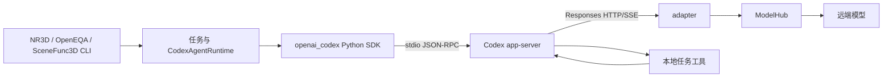

# GPT 与 Gemini 的推理状态透传、Codex 适配和前缀缓存验证

记录日期：2026-11-03。环境：本机 Linux，`agentic3d`，办公网络。本文整合当前协议实测、真实 Codex SDK 链路测试及历史 NR3D v5/v6 记录，并提供新会话的复现操作。本文包含用户指定的实际 AK，保存在本地资料目录。

## 1. 已验证的结论

| 问题 | 结论 | 证据范围 |
| --- | --- | --- |
| GPT 后续使用什么协议？ | 使用原生 Responses；禁止 GPT 转 Chat 和自动降级。 | 用户决定已写入仓库 `AGENTS.md`；当前生产 adapter 已是 Responses-only。 |
| GPT 加密 reasoning 能否跨工具调用保留？ | 可以。完整 Responses output 原样累积到下次 input，密文 hash 一致；改一个字符被拒绝。 | `gpt-6-luna` 的直接 HTTP 五请求、三工具实验；本组未经过 Codex SDK。 |
| Gemini 的 Chat 外形接口是否包含推理状态？ | 包含原生 `signature` 扩展字段；出现在 assistant、tool call、multimodal part。不能只保留标准 Chat 字段。 | `gemini-3.8-flash` 的 `/v2/crawl` 实测。 |
| Codex → adapter → Gemini 是否可以完整往返这些状态？ | 本次实验桥接可以：Codex 回传状态句柄，adapter 恢复完整原生 assistant message；工具和多轮状态校验通过。 | 真实 SDK 0.163.0、bundled Codex 0.163.0、实验 adapter 8791。 |
| 缓存是否覆盖历史 reasoning？ | 按上游 usage 和匹配对照的计数口径，真实 SDK 最终轮至少 **3,315 个 cached tokens** 来自历史 reasoning/state。 | `8626−698=7928` 对应历史 reasoning 总量；`4013−698=3315` 给出保守下界。 |
| 能否保证每轮命中、全部 reasoning 被缓存？ | 不能。存在零命中轮次，也存在尚未解释的输入 token 统计异常。 | 完整保留成功、失败、阴性和异常记录。 |

“原样传回状态”“上游接受状态”“缓存读取”“任务精度改善”是四个不同层次。本次证据覆盖前三项中的具体条件，不据此宣称任务精度提高或所有请求的内部执行完全一致。

## 2. 接口、模型和本次 AK

办公网络统一使用：

```text
https://aidp-i18ntt-sg.tiktok-row.net
```

用户原始示例域名为 `https://aidp-i18ntt-sg.byteintl.net`。路径里的 `/online` 不是网络区域标识；办公网络变更的是域名。

| 模型 | 本次成功接口 | effort | 请求输出限制 |
| --- | --- | --- | --- |
| `gpt-6-luna` | `/api/modelhub/online/unified/v1/responses` | `medium` | `max_output_tokens=1600` |
| `gemini-3.8-flash`，直接工具实验 | `/api/modelhub/online/v2/crawl` | 省略，使用上游默认值 | `max_tokens=4096` |
| `gemini-3.8-flash`，SDK/缓存实验桥 | 同上 | 省略，使用上游默认值 | `max_tokens=8192` |

实际凭据如下，与同目录的 `credentials.env` 一致。复现时 `source` 该文件，启动器从对应环境变量读取；AK 不作为命令行参数或日志内容传递。

```bash
export MODELHUB_GPT_AK='IGZwDWSbM3C2Mwq4qOcM5VJAD16RLzr2_GPT_AK'
export MODELHUB_GEMINI_AK='2YF3uPccg2AJNejeWETopd041Tc9TnIt_GPT_AK'
```

每个实验会话从开始到结束使用同一个 AK。不同模型的 AK 不混用。固定 AK 是本次实验的约束，未测试跨 AK 迁移，也不能将它等同于永久固定底层厂商账号或实例。

## 3. CLI、SDK、adapter 与模型的职责

仓库正常任务的分层是：



任务 CLI 负责数据、实验配置、并发和结果记录；runtime/SDK 负责启动 Codex 进程、thread 与 turn；Codex 负责模型调用和工具调度；adapter 负责协议与路由，不能代替任务工具执行。OpenEQA judge、query parser 和 SceneFunc3D 的 Molmo/SAM sidecar 是另外的调用链，不会因为 Codex adapter 改造而自动迁移。

本次 Gemini v3 没有运行数据集 CLI，而是用真实 SDK 的小型 driver 创建隔离 thread，直接验证更底层的状态和工具链：

```text
sdk_driver.py / sdk_cache_driver.py
  → openai_codex 0.163.0
  → bundled Codex app-server 0.163.0
  → http://127.0.0.1:8791/v1/responses
  → 实验 bridge.py
  → https://aidp-i18ntt-sg.tiktok-row.net/api/modelhub/online/v2/crawl
  → gemini-3.8-flash
```

生产目录仍叫 `codex_modelhub_adapter/`；生产服务 8787 未被替换。本文中的 Gemini codec 是独立实验实现，未来命名 `codex_adapter` 及生产化改造尚未完成。

## 4. GPT：Responses 的密文回传证据

### 4.1 请求方式

关键设置如下。工具定义及工具结果由归档 probe 完整生成；此处展示的是协议要点。

```json
{
  "model": "gpt-6-luna",
  "stream": false,
  "store": false,
  "reasoning": {"effort": "medium"},
  "include": ["reasoning.encrypted_content"],
  "max_output_tokens": 1600,
  "input": [{"role": "user", "content": "本轮用户任务"}]
}
```

收到响应后，下一轮的构建原则是：

```python
history.extend(response["output"])  # 所有 item 原样保留，包含 reasoning items
history.append({
    "type": "function_call_output",
    "call_id": original_call_id,
    "output": tool_result_json,
})
next_body["input"] = history
```

不得只提取最终文本；也不得将 `reasoning.encrypted_content` 改写为普通 assistant 文本。实验使用显式完整历史，不依赖 `previous_response_id` 或服务端存储。`reasoning_tokens` 是计数，不是可回传的状态载荷。

### 4.2 五请求工具链和破坏对照

工具 `lookup_record` 返回 alpha=137、beta=211，以及本地预先随机生成、仅随工具结果提供的 receipt。模型需要返回最初的随机 marker、和 348、两张 receipt。首轮完成后再要求调用 alpha 并复述原始答案，迫使密文跨后续请求回传。

| 请求 | 输出 | 新密文长度 | 本次输入携带的既有密文 |
| --- | --- | ---: | --- |
| 1 | alpha 工具调用 | 无 | 无 |
| 2 | beta 工具调用 | 无 | 无 |
| 3 | 正确初始 JSON | 1,572 字符 | 无 |
| 4 | 追问后的 alpha 工具调用 | 3,020 字符 | 原始 1,572 字符密文 |
| 5 | 正确最终 JSON | 无 | 前两份密文原样保留 |

主链五次全部 HTTP 200，三次工具执行，历史 output items 的累计 hash 一致。改变第一份密文一个字符，返回 `400 invalid_encrypted_content`。删除包含密文的整个 reasoning item 后返回 200，只说明可见历史仍能回答该简单任务，不能据此声称状态未损失；生产实现不能把这种删除作为自动修复。

另外一个三请求实验直到最后才出现密文，因此它只能证明“输出了密文”，五请求追问实验才验证了“下一轮回传”。全部 GPT v1 请求的缓存计数为零，本组没有正向缓存证据。

### 4.3 GPT Chat 的历史探测结果

| 路径 | 本次观察 |
| --- | --- |
| `/v2/crawl` | 403，提示此 GPT 模型已不在该接口提供，需统一协议。 |
| `/unified/v1/chat/completions`，medium + function tools | 400，明确要求使用 Responses 或 effort none。 |
| 同一 Chat 接口，effort none | 工具链成功，没有观察到 opaque state。 |

这些是已完成的历史诊断，不是当前允许的 GPT 路由。复现入口仅提供 GPT Responses。成功 Chat 和 Responses 返回的 model 标识形式不同，也没有证明底层权重完全相同。

### 4.4 NR3D v5 与 v6 到底差在哪

| 历史实验 | Codex → adapter | adapter → 上游 | 配置 | Acc@0.25 | mean_cache_ratio |
| --- | --- | --- | --- | ---: | ---: |
| v6 | Responses | Chat `/v2/crawl` | medium，summary off | 80.33% | 0.577 |
| v5 | Responses | 原生 `/responses` | medium，summary auto | 85.33% | 0.9136 |

这是旧 `gpt-5.4-2026-03-05`、canonical strat600 的实验，不是当前 `gpt-6-luna`。旧 mapper 在 summary 开启时自动选择 Responses；Chat 路径丢弃 reasoning items。**当时 Chat 有前缀缓存，并不证明它保留了加密 reasoning。** v5 的上游请求确实是 Responses，但旧 adapter 有请求规范化，包括 `store=true`，不能说是今天意义上的所有字段完全直通。

v5 比 v6 高 5 个百分点是路径级观测；summary、协议对 effort 的实际执行、失败数等同时不同，不能将差值独立归因于密文回传。历史文档中的强因果表述应按这个限制解读。Gemini 在 Chat 扩展字段中携带 signature，也不能反推旧 GPT mapper 已经实现了相同机制。

## 5. Gemini：签名在哪里，怎么回传

### 5.1 实际字段

本次 `/v2/crawl` 的 Chat 外形响应在以下位置返回 signature：

```text
choices[0].message.signature
choices[0].message.tool_calls[i].signature
choices[0].message.multimodal_contents[i].signature
```

`multimodal_contents` 中的文本 part 也可以有签名，不限于图片。13 个成功响应的可读 `reasoning_content` 都为空，其中 11 个报告了非零 reasoning tokens，另外两个没有该计数字段。可读 reasoning 为空，不表示没有内部推理；缺失字段也不等于测得零。

把这些字段统一叫“加密块”便于讨论，但客户端实际知道的是上游 opaque signature/state，不能自行推断其编码、加密算法或内部内容。signature 字符长度也不是 reasoning token 数。

### 5.2 完整 assistant message 是回传单位

```python
assistant = response["choices"][0]["message"]
messages.append(assistant)  # 包括扩展字段、各层 signature、原始 tool_calls
messages.append({
    "role": "tool",
    "tool_call_id": original_native_call_id,
    "content": tool_result_json,
})
```

实际测试中原生 tool-call ID 曾为空字符串；直接 HTTP 路径按原值匹配，SDK 桥则另建 Codex 侧非空 ID，并保存双向关联，回上游时还原原生 ID。不能只改 assistant 的 ID 而忘记对应工具结果。当前实验仅覆盖顺序单工具调用，未验证并行工具和所有多模态组合。

### 5.3 对照结果说明哪些字段不能丢

| 对照 | HTTP | 能得出的结论 |
| --- | ---: | --- |
| 完整原样回传 | 200 | 五请求、三工具主链通过，marker、348 和原始 receipts 保持正确。 |
| 只破坏 message-level signature | 200 | 正确的 tool-call copy 仍在；不能推导所有 signature 可省略。 |
| 只破坏 tool-call signature | 400 | `Invalid thought signature`，code `-4003`。 |
| 破坏所有 signature copies | 400 | 同样拒绝。 |
| 删除所有 signature copies | 400 | 工具续接要求前序签名原样回传。 |

另有一个图片请求测试成功，报告 1,080 个 IMAGE input tokens；因为答案不依赖图像内容，仅证明输入接受和工具续接，不是视觉精度测试。初次 `crawl` 的 fenced JSON 被严格解析器判为失败，这个原始失败保留在记录中。

## 6. Codex 如何携带 Gemini 原生状态

### 6.1 实验桥的转换过程

1. Codex 向本地桥发送 Responses 请求。
2. 桥识别已有 `reasoning.encrypted_content` 句柄，验证 HMAC、会话绑定和已有状态顺序。
3. 桥从内存取回完整 Gemini assistant message，恢复所有 signature、tool call 和原生字段，构造完整 Chat messages。
4. 桥向 ModelHub 发起非流式请求，收到完整原生 assistant 后将其保存到内存。
5. 桥为该状态生成 `a3d-gemini-state-v1:<nonce>:<hmac>` 句柄，通过 Responses reasoning item 返回给 Codex；同时映射 tool calls / assistant 输出。
6. Codex 将 reasoning item 保存在 thread 历史，下次原样带回；工具由 SDK dynamic tool handler 执行，再由 Codex 发起后续模型调用。

这是**经认证的内存状态引用**，不是把 Gemini 密文重新加密成 OpenAI 原生密文，也不是自包含、可迁移的状态包。选择 reasoning item 作为载体，是因为本次 Codex 版本会保留该位置的 encrypted_content；任意额外 JSON 字段并不保证被 Codex 历史保留。

桥在 Codex 侧提供 Responses SSE；上游 `stream=false`，获得完整结果后生成 SSE 事件。因此本次证明的是 SSE 兼容与状态往返，不是上游逐 token 原生 streaming。

### 6.2 AK 与会话绑定

```text
复现启动器读取 MODELHUB_GEMINI_AK
  → driver 向该 Codex 子进程注入 PROBE_UPSTREAM_AK、PROBE_SESSION_ID
  → provider.env_http_headers：
      X-Codex-Upstream-AK ← PROBE_UPSTREAM_AK
      X-Codex-Session-ID ← PROBE_SESSION_ID
  → bridge 校验同一 session 的 AK 绑定
  → ModelHub 请求：query ak=<同一个 AK>
                   header extra='{"session_id":"<同一个会话 ID>"}'
```

服务没有 AK 池，不自行选择或轮换 AK；不重试换账号，不降级丢状态。相同 session 配不同 key、缺失已知 carrier 或状态不匹配时拒绝请求。driver 中的原生 shell tools 被关闭，实验只暴露 `lookup_record`，或在缓存实验中不暴露工具。

`extra` 是 JSON 字符串 header，不是单独的 `session_id` header。`X-TT-LOGID` 可逐请求变化。桥的 `client_metadata` / `prompt_cache_key` 仅用于 trace，本实验真正用于 ModelHub 亲和路由的是稳定的 `extra.session_id`。

### 6.3 已通过与尚未实现的能力

真实 SDK 工具实验两次均完成两个用户 turn、五次模型请求、三次工具调用，工具顺序 alpha → beta → alpha，原始答案校验通过。三个缓存会话分别完成 9、10、11 个 turn。所有成功 SDK 会话的 saved/restored 原生 message hash 和顺序匹配，usage 转换与 SDK 计数对齐。

实验 bridge 不支持重启后的句柄恢复、compact、图片链路、持久 session resume、跨 provider 通用映射。未知能力应显式拒绝，不能据此直接替换生产 adapter。Gemini 不是只改一个 base_url 就能成为 Codex 的无损 Responses provider。

## 7. 缓存证据：为什么确定覆盖了部分 reasoning

### 7.1 请求设计

不堆长文本。首个 direct seed 只有 68 个输入 tokens，用字母算式引导内部校验，只输出答案映射：

```text
Solve the base-10 alphametic CROSS + ROADS = DANGER. Different letters are
different digits; leading letters are nonzero. Do not assume a memorized answer:
check column constraints and verify the solution carefully internally. Use no
tools or code. Output only one valid digit mapping and its arithmetic check,
with no reasoning text.
```

SDK 版还包含 Codex 自带的权限/环境文本，第一轮合计 196 input tokens，去签名对照保留这些内容。最终成功命中的会话使用三个短题：CROSS + ROADS = DANGER、DONALD + GERALD = ROBERT、SATURN + URANUS = PLANETS；之后连续八轮仅要求回复 OK，每轮间隔 2 秒。未读取或输出原始隐藏思考，也没有把签名当普通文本拼进 prompt。

### 7.2 两组独立证据

| 指标 | Direct HTTP 重复相同 body | 真实 Codex SDK 增长历史 |
| --- | ---: | ---: |
| 记录 | `cache_reasoning_repeat` | `sdk_cache3` 第 11 轮 |
| 完整状态输入 P | 8,028 | 8,626 |
| 保留全部可见历史、移除签名后的输入 V | 165 | 698 |
| 历史 reasoning token 数 H | 7,863 | 7,928 |
| P − V | 7,863 | 7,928 |
| 上游报告 cached tokens C | 4,072 | 4,013 |
| reasoning/state 缓存保守下界 max(0, C − V) | **3,907** | **3,315** |

推导方法：即使假设全部可见 token 都已缓存，cached tokens 超过全部可见输入的部分，也不能归属于可见文字。完整输入与去签名输入的差又恰好等于历史 reasoning 计数，因此按这些 usage 的口径，缓存读取包含历史 reasoning/state。这里依据的是上游计数和匹配对照，不是查看厂商 KV 存储。

SDK 的历史 reasoning 总量为：

```text
3433 + 1600 + 2810 + 29 + 28 + 28 = 7928
8626 − 698 = 7928
4013 − 698 = 3315
```

严格对照保留 `max_tokens=8192`、模型、session、AK、全部可见消息，仅移除模型输入中的 20 个 signature 字段。归档中被脱敏的空 `reasoning_content` 只有在空串 hash 校验一致时才重建。对照为 HTTP 200、input=698、cached=0。较早的 `max_tokens=128` 对照也得到 698，但因输出上限不同只作辅助证据。

注意：文本 ACK 会话的去签名对照能返回 200，与工具续接时去签名返回 400 不矛盾；请求类型和上下文不同。去签名仅用于 token 归因，不是生产回退策略。

### 7.3 SDK 最终会话的完整时间线

| turn | input tokens | cached input tokens | 本轮新 reasoning tokens |
| --- | ---: | ---: | ---: |
| 1 | 196 | 0 | 3,433 |
| 2 | 3,764 | 0 | 1,600 |
| 3 | 5,511 | 0 | 2,810 |
| 4 | 8,422 | 0 | 29 |
| 5 | 8,468 | 4,051 | 28 |
| 6 | 8,513 | 0 | 28 |
| 7 | **630** | 0 | 0（SDK 归一化值） |
| 8 | 8,575 | 4,032 | 0（SDK 归一化值） |
| 9 | 8,592 | 4,025 | 0（SDK 归一化值） |
| 10 | 8,609 | 0 | 0（SDK 归一化值） |
| 11 | 8,626 | 4,013 | 0（SDK 归一化值） |

后几轮原生响应可能省略 reasoning 计数字段，SDK 的归一化零不应解释为逐项测得零。原生 raw usage 保存在归档，可与归一化结果区分。

第 7 轮虽然 adapter 恢复 hash 正确，上游仅报告 630 个输入 tokens；direct 重复组的第一次相同 body 也只报告 165，并以 `finish_reason=length` 结束。原因未确定。后续请求恢复正常计数，因此不能说客户端透传正确就证明每次上游都同样处理或统计了隐藏状态。

### 7.4 阴性结果和缓存条件

一个 seed 的 SDK 会话最后 `5549−411=5138`，两个 seed 的会话 `5870−553=5317`，都对应历史 reasoning，但没有缓存命中。direct 第一组生成 5,156 reasoning tokens，三次 replay 也全未命中。长可见前缀对照则在第三次请求命中 4,078 tokens。这些结果排除了“只要 signature 原样回传就必然命中”的说法。

用户提供的缓存指南要求平台与业务—模型两个亲和开关开启、传稳定的 `extra.session_id`；GCP Gemini 的账号映射 TTL 标为 5 分钟。指南一处给出输入大于 2,048 tokens，后文通用建议又说通常 4k 以上，不能据此推断本模型精确阈值。平台开关状态和底层账号身份没有被本实验独立观测。

固定 AK/session、维持相同前缀、连续请求，有助于满足缓存条件；服务端容量、路由、淘汰仍可能导致未命中。客户端能够保证自己的状态完整性，不能单方面保证服务端每次缓存命中。重新执行应复现流程与判定方法，不承诺相同思考长度、命中轮次或具体数字。

## 8. 可复现操作

### 8.1 准备独立干净 worktree

以下操作针对本机已有 `agentic3d` 环境，不安装依赖，不修改生产服务。源代码固定为 `255b091849c0bafeef8f5e494d022a7750eefa91`。主工作区可以有文档改动，执行模型请求的 worktree 必须没有 tracked drift。归档中的脚本还需单独记录 hash，不能只记录 Git HEAD。

先在终端执行以下准备步骤（尚不发模型请求）：

```bash
repo_root=/home/ysh/codebase/agentic-3d-task
private_dir="$repo_root/local-notes/modelhub_gpt_gemini_20261103"
repro_id="$(date +%Y%m%d_%H%M%S)"
probe_worktree="$repo_root/.worktrees/modelhub_repro_$repro_id"
probe_dir="$probe_worktree/tmp/modelhub_probe"
artifact_root="$repo_root/docs/benchmark/adapter/assets"
run_root="$probe_worktree/tmp/REPRO_${repro_id}_modelhub_20261103"
tmux_name="modelhub_repro_$repro_id"

git -C "$repo_root" worktree add --detach "$probe_worktree" \
  255b091849c0bafeef8f5e494d022a7750eefa91
mkdir -p "$probe_dir" "$run_root"
cp "$artifact_root/v1_modelhub_tool_state_20261103/probe.py" "$probe_dir/gpt_probe.py"
cp "$artifact_root/v2_gemini_tool_state_20261103/probe.py" "$probe_dir/gemini_probe.py"
for probe_file in bridge.py sdk_driver.py sdk_cache_driver.py cache_probe.py \
  probe_support.py exact_accounting_control.py control_client.py test_bridge.py; do
  cp "$artifact_root/v3_codex_gemini_cache_20261103/$probe_file" "$probe_dir/"
done
cp "$artifact_root/v3_codex_gemini_cache_20261103/long_reasoning_prompt.txt" "$probe_dir/"
cp "$private_dir/env_probe.py" "$probe_dir/"
git -C "$probe_worktree" status --porcelain --untracked-files=no

{
  printf 'export repo_root=%q\n' "$repo_root"
  printf 'export private_dir=%q\n' "$private_dir"
  printf 'export probe_worktree=%q\n' "$probe_worktree"
  printf 'export probe_dir=%q\n' "$probe_dir"
  printf 'export run_root=%q\n' "$run_root"
  printf 'export tmux_name=%q\n' "$tmux_name"
} > "$private_dir/repro-context.sh"

tmux new-session -d -s "$tmux_name" -n server -c "$probe_dir" 'zsh -i'
tmux new-window -t "$tmux_name" -n client -c "$probe_dir" 'zsh -i'
tmux attach-session -t "$tmux_name"
```

`git status` 应没有输出；否则先解决执行工作树的改动。新建 tmux 的交互 zsh 会读取本机网络配置；不要使用可能缺少必要网络环境的旧 tmux shell。下面的服务和模型请求都在这个专用 tmux 中运行。

脚本必须位于 `<worktree>/tmp/modelhub_probe/` 这样的两级目录：它们通过 `Path(__file__).parents[2]` 找仓库根，不能直接从深层 docs assets 路径运行。不要复制归档 `runtime_config.json` 作为运行配置：其中有已结束临时目录的路径；脱敏后的 catalog 也不是可运行配置。driver 会重新生成正确配置。

### 8.2 在 server 窗口启动实验桥

```bash
source /home/ysh/miniconda3/etc/profile.d/conda.sh
conda activate agentic3d
source /home/ysh/codebase/agentic-3d-task/local-notes/modelhub_gpt_gemini_20261103/repro-context.sh
cd "$probe_dir"
PROBE_TRACE_DIR="$run_root/bridge_traces" python -m uvicorn bridge:app \
  --host 127.0.0.1 --port 8791 --no-access-log --log-level warning
```

若端口占用，先确认归属，不能停止其他会话的服务；本文使用固定 8791，8787 是已有生产 adapter。服务启动时不需要 AK；每个请求自带该 Codex 会话的 key。服务进程需一直运行到 SDK/cache 测试完成，重启会丢失内存句柄。

不要加 `--reload` 或多个 worker：这份实现的 HMAC key 与状态都在单个进程内。

### 8.3 在 client 窗口加载环境

```bash
source /home/ysh/miniconda3/etc/profile.d/conda.sh
conda activate agentic3d
source /home/ysh/codebase/agentic-3d-task/local-notes/modelhub_gpt_gemini_20261103/repro-context.sh
set +x
source "$private_dir/credentials.env"
cd "$probe_dir"
curl -fsS http://127.0.0.1:8791/health
python -c 'import importlib.metadata as m; print(m.version("openai-codex"))'
```

本次验证版本为 `openai-codex=0.163.0`。health 仅证明本地桥存活，不证明 AK 或上游可用。SDK driver 会单独创建 HOME/CODEX_HOME、模型 catalog 和配置，并调用低层 client 的 `initialize()`；不要替换成全局 Codex 配置。driver 关闭 native tools、skills、plugins、multi-agent、compact、WebSocket 和自动请求/流重试，保留本实验所需的动态工具。

`env_probe.py` 仅替换归档脚本的凭据加载入口与 summary 的凭据来源标签，模型请求、历史构造、对照与校验代码沿用归档版本；它会生成单独的 `.launch.json`，记录自身及脚本 hash。历史脚本要求的 transcript 参数由启动器占位，实际不会读取聊天文件。下面各输出目录必须尚不存在；失败重跑请换新名字，保留失败产物。

### 8.4 GPT Responses 密文回传

```bash
timeout 480 python env_probe.py gpt_probe.py \
  --output "$run_root/REPRO_gpt_responses_replay" \
  --protocol responses --effort medium --followup --controls
```

预期主链五请求、三工具；两组诊断对照另计。检查 `summary.json` 的主链结果、历史 hash 和 `control_corrupted_response.json` 的错误；缓存可以是零。启动器拒绝 GPT Chat 路由。实际生成的密文长度和 reasoning 数不要求与历史运行相同。

### 8.5 Gemini 原生工具签名

```bash
timeout 480 python env_probe.py gemini_probe.py \
  --output "$run_root/REPRO_gemini_crawl_replay" \
  --protocol legacy_chat --followup --controls
```

预期主链五请求、三工具，并执行四组签名对照。检查完整 assistant replay hash，区别 message-level 与 tool-call-level 的破坏结果。若要独立验证图片接受，可另起新输出目录运行 `--protocol legacy_chat --image`。

### 8.6 真实 SDK 工具链

```bash
timeout 480 python env_probe.py sdk_driver.py \
  --output "$run_root/REPRO_sdk_smoke4" \
  --adapter-url http://127.0.0.1:8791/v1
```

预期两个 SDK turn、五次上游请求、三次动态工具执行；随机 marker 与 receipts、348 和工具顺序均需校验。可另起目录并加 `--prompt-file long_reasoning_prompt.txt` 复现长思考工具变体。不能将普通 assistant 文本里的“调用工具”当成工具执行证据。

### 8.7 真实 SDK reasoning 缓存与严格对照

```bash
timeout 480 python env_probe.py sdk_cache_driver.py \
  --output "$run_root/REPRO_sdk_cache3" \
  --adapter-url http://127.0.0.1:8791/v1 --second-seed --third-seed &&
timeout 180 python env_probe.py exact_accounting_control.py \
  --summary "$run_root/REPRO_sdk_cache3/summary.json" \
  --trace "$run_root/bridge_traces/bridge_trace.jsonl" \
  --output "$run_root/REPRO_sdk_cache3_exact_control"
```

仅当第一个命令成功完成 11 个 turn 后运行严格对照；summary 和 trace 都必须来自本次新会话。对照沿用该会话的 session 与 AK、最后一条正常请求及 `max_tokens=8192`。这一步会真实调用一次上游模型。不要把历史脱敏 JSON 当成完整带密文请求重放；原始 signature 不在归档中。

判定时分别记录 P（完整输入）、V（仅去签名输入）、C（cached tokens）、H（历史 reasoning 累计），检查 P−V 与 H 是否对应，以及 C−V 是否严格大于零。driver 的 `passed` 只表示会话完成，不代表缓存必然命中或字母算式答案经过精度评测。若 C≤V，这次重跑不能证明缓存覆盖 reasoning，应记录为阴性，不套用历史 3,315 的结论。

可以直接运行以下只读核对。它同时检查会话、控制请求来源、恢复 hash 和原生/SDK 计数；遇到缺失请求或不匹配会显式失败：

```bash
python - "$run_root" <<'PY'
import json
import sys
from pathlib import Path

root = Path(sys.argv[1])
run = json.loads((root / "REPRO_sdk_cache3/summary.json").read_text())
control = json.loads((root / "REPRO_sdk_cache3_exact_control/summary.json").read_text())
assert run["result"] == "passed" and run["all_acknowledgements_ok"]
assert control["http_status"] == 200 and control["max_tokens"] == 8192
assert control["session_id"] == run["session_id"]
rows = [json.loads(line) for line in (root / "bridge_traces/bridge_trace.jsonl").read_text().splitlines()]
rows = [row for row in rows if row.get("session_id") == run["session_id"] and row.get("kind") != "visible_token_control"]
assert len(rows) == len(run["turns"]) == 11
expected = []
for row, turn in zip(rows, run["turns"]):
    assert row["upstream_status"] == 200
    assert row["restored_states"] == expected
    expected.append(row["saved_state"])
    usage = row["raw_usage"]
    sdk = turn["usage"]["last"]
    assert sdk["inputTokens"] == usage["prompt_tokens"]
    assert sdk["cachedInputTokens"] == usage.get("prompt_tokens_details", {}).get("cached_tokens", 0)
assert control["source_request_id"] == rows[-1]["request_id"]
last = rows[-1]["raw_usage"]
P = last["prompt_tokens"]
V = control["usage"]["prompt_tokens"]
C = last.get("prompt_tokens_details", {}).get("cached_tokens", 0)
H = sum(turn["usage"]["last"]["reasoningOutputTokens"] for turn in run["turns"][:-1])
print(json.dumps({"P": P, "V": V, "C": C, "reported_H": H,
                  "state_input_delta": P - V,
                  "reported_reasoning_matches_delta": P - V == H,
                  "reasoning_cache_lower_bound": max(0, C - V),
                  "positive_cache_evidence": P - V == H and C > V}, indent=2))
PY
```

部分 direct/control 脚本即使 HTTP 失败也可能退出 0，不能只看 shell 退出码；必须读 summary 的 `http_status`、`result` 和 raw usage。严格对照脚本可在 bridge 停止后读取完整 trace 直接调用上游，但应紧接主实验完成执行，以减少路由/时间差异。

可选 direct HTTP 对照：

```bash
timeout 480 python env_probe.py cache_probe.py \
  --output "$run_root/REPRO_cache_reasoning_repeat" \
  --case reasoning --repeats 8 --delay 2

timeout 480 python env_probe.py cache_probe.py \
  --output "$run_root/REPRO_cache_visible" \
  --case visible_prefix --repeats 3
```

direct reasoning 组的八次 replay 使用相同 body；SDK 组逐 turn 增长历史，二者不能混为一个实验。每个会话新建 session，但会话内部固定。完成后在 server 窗口 Ctrl-C 停止自己启动的桥即可。

### 8.8 复现结果如何归档

每次新运行保留命令、HEAD、branch/detached、tracked drift、执行脚本 hash、model/effort/session、各请求 usage、工具结果和状态 hash。输出前缀含 `REPRO_` 与新日期；不要覆盖本文所引用的原始目录。

新结果应新建 `docs/benchmark/adapter/` 日期记录，导入该类别的 SQLite，更新该目录 timeline/index。现有 `ingest.py` 是原始版本的归档导入器，直接执行不会自动发现任意新 `run_root`；新运行需要按实际路径扩展导入或单独登记，不能声称已经入库。本文编写阶段未再发模型请求，未新增一轮实验。

## 9. 对生产改造的约束

| 层 | 建议职责与不变量 |
| --- | --- |
| 实验 launcher / CLI | 接受 model + AK 引用 + effort + provider codec 的实验矩阵；启动会话时选定一次。每会话保存不可变配置身份，恢复时校验。 |
| Codex 进程 | 全程使用同一会话的 key 与 session；provider 在 Codex 侧固定 `wire_api=responses`。 |
| `codex_adapter` | 进行 capability 校验、路由和 provider codec 转换；校验 session/key/model/endpoint/codec 绑定；重试不得轮换 AK 或删除状态。 |
| GPT codec | 原生 Responses 直通并保留完整 reasoning/output items；不提供 Chat fallback。 |
| Gemini codec | 保留完整原生消息、所有 signature 及工具关联；版本化状态载体，验证历史恢复顺序。 |
| 持久状态层 | 生产需要支持重启/resume 的状态恢复与完整性校验；内存 HMAC handle 只是本次验证方案。 |
| 缓存观测 | 同时记录原生和标准化 usage、session/key 指纹及路由线索，识别命中与计数异常，不把缓存设为必然成功条件。 |

AK 的**选择和会话生命周期**属于 launcher/进程；adapter 仍需读取请求里的 AK 用于上游认证，并可保存非明文绑定指纹进行一致性校验。“不管理 AK 池”不等于 adapter 完全看不到 AK。当前生产池化/429 路由不能直接当成严格会话 key 不变的保证，需要生产改造与相应回归测试。

Claude 或其他 provider 需要各自的原生状态/签名 codec 和实测，本次未测试。不能将 Gemini signature、OpenAI encrypted_content 或未来 Claude 的 signed thinking 按名称互换，也不能把隐藏状态摘要成可见文字后称为无损。

## 10. 证据、版本和验证记录

| 记录 | 子运行 | 上游请求 | 工具执行 | 主要边界 |
| --- | ---: | ---: | ---: | --- |
| GPT v1 | 5 | 15 | 7 | 直接 HTTP；12×200、2×400、1×403；cached=0。 |
| Gemini v2 | 3 | 17 | 7 | 直接 HTTP；13×200、4×400；cached=0。 |
| Gemini v3 | 11 | 65 | 6 | 64×200、1×400；34 个 SDK turn 成功；包含 cache controls 和启动失败。 |
| 合计 | 19 | 97 | 20 | 不是模型成功率或任务精度基准。 |

v3 的两个最早启动失败没有发出模型请求，原因是低层 SDK 缺少 initialize；之后一次上游 400 的原始文字仅存 hash，不能重建其精确原因。补充 developer→system 映射后运行成功，但这不能替代缺失错误正文的根因证明。

归档 v3 的 688 个 manifest 条目和 36 条执行源码引用已重新核对 hash。原始实现验证为 16 个 mock tests 通过、当前探针 Ruff/Black 通过、bridge mypy 通过、MkDocs build 通过（有既存告警）。本次文档及新凭据启动器的验证以同目录 `document_verification.json` 为准；未因撰写文档重复收费模型请求。生产源代码未在此阶段修改。

相关文件：

- [GPT v1 完整记录](../../docs/benchmark/adapter/v1_modelhub_tool_state_20261103.md)
- [Gemini v2 完整记录](../../docs/benchmark/adapter/v2_gemini_tool_state_20261103.md)
- [Codex Gemini v3 完整记录](../../docs/benchmark/adapter/v3_codex_gemini_cache_20261103.md)
- [v3 分析数据](../../docs/benchmark/adapter/assets/v3_codex_gemini_cache_20261103/analysis.json)
- [v3 严格计数对照](../../docs/benchmark/adapter/assets/v3_codex_gemini_cache_20261103/sdk_cache3_exact_control/summary.json)
- [v3 来源与完整性清单](../../docs/benchmark/adapter/assets/v3_codex_gemini_cache_20261103/manifest.json)
- [v3 执行源码版本校验](../../docs/benchmark/adapter/assets/v3_codex_gemini_cache_20261103/source_versions_verified.json)
- [历史 NR3D v5](../../docs/benchmark/nr3d/v5_summary_responses_strat600_20260611.md) 与 [v6](../../docs/benchmark/nr3d/v6_effort_ablation_chat_strat600_20260611.md)
- [历史 reasoning/缓存/AK 机制分析](../../docs/codex_agent/reasoning_carryover_caching_ak_routing_20260611.md)
- [用户提供的缓存指南](</home/ysh/.codex/attachments/92de24fe-8945-4e1b-bf1d-f88994ba1393/Pasted text.txt>)：本次缓存条件的直接来源。
- [ModelHub 统一协议 wiki](https://bytedance.larkoffice.com/wiki/RP51wPyj1i6Yi8kHRV4ck44Onw2)：用户指定接口文档；本次未取得页面读取授权，接口结论来自实际请求，不声称已核对其全文。

原始证据中的 opaque state 已替换为长度/hash，适合审计，不足以重放旧会话。复现脚本应生成新的原生状态，并在同一会话内原样续接。按用户明确要求，本文、`credentials.env`、凭据启动器和验证记录一并纳入 Git 版本管理并提交推送；文档中保留本次实际 AK。该目录位于 MkDocs 的 `docs/` 之外，未加入文档站点导航。
